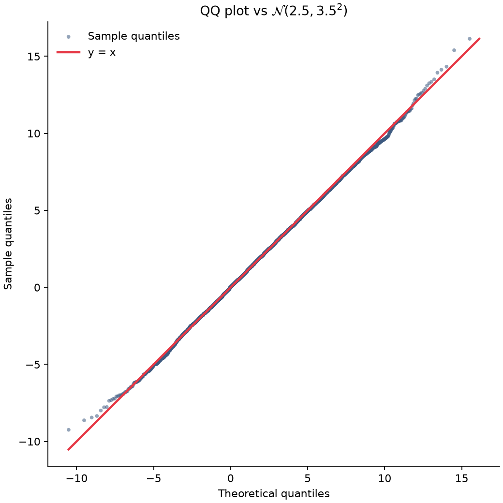

# Gaussian Sampling with the Box–Muller Transform

Portfolio case study: a small, reproducible pipeline that draws i.i.d. Gaussian samples in C and validates them against the theoretical distribution in Python.

$$
X \sim \mathcal{N}(\mu, \sigma^2),
\qquad
f_X(x)=\frac{1}{\sigma\sqrt{2\pi}}
\exp\left(-\frac{(x-\mu)^2}{2\sigma^2}\right)
$$

## What this project demonstrates

- **Numerical sampling** via the polar Box–Muller method (rejection sampling on the unit disk, twin-sample caching).
- **Separation of concerns**: portable C sampler + thin Python analysis / visualization layer.
- **Reproducible runs** through CLI flags, Makefile parameters, and an explicit RNG seed.
- **Quantitative validation**: moment errors, Kolmogorov–Smirnov distance, histogram-vs-PDF and QQ plots.
- **Automated checks**: C unit smoke test, Python unit + pipeline tests, GitHub Actions CI.

## Repository layout

```text
├── src/
│   ├── box_muller.h / .c   # Public sampling API
│   └── main.c              # CLI entry point
├── scripts/
│   ├── gaussian_stats.py   # PDF/CDF/PPF + diagnostics
│   └── visualize.py        # Histogram + QQ figures
├── tests/
│   ├── test_box_muller.c
│   ├── test_gaussian_stats.py
│   └── test_pipeline.py
├── docs/
│   └── methodology.md
├── .github/workflows/ci.yml
├── Makefile
└── requirements.txt
```

Generated outputs (`bin/`, `data/`, `figures/`) are ignored by git.

## Requirements

- GCC (C11) with `libm`
- Python 3.10+
- `numpy`, `scipy`, `matplotlib` (see `requirements.txt`)

```bash
python3 -m venv .venv
source .venv/bin/activate
pip install -r requirements.txt
```

## Quick start

Default run ($N=5000$, $\mu=2.5$, $\sigma=3.5$, seed $42$):

```bash
make
```

This builds `bin/gaussian_sampler`, writes `data/sample.dat`, and saves:

- `figures/histogram_vs_pdf.png`
- `figures/qq_plot.png`

### Custom parameters

```bash
make N=10000 MU=0 SIGMA=1 SEED=7 BINS=60
```

### Tests

```bash
make test
```

### Direct CLI usage

```bash
make bin/gaussian_sampler
./bin/gaussian_sampler --n 5000 --mu 2.5 --sigma 3.5 --seed 42 --output data/sample.dat
python3 scripts/visualize.py --input data/sample.dat --mu 2.5 --sigma 3.5 --bins 50
```

## Design notes

| Concern | Choice |
| --- | --- |
| Sampling | Polar Box–Muller with cached spare normal |
| Uniforms | `rand()` for clarity; swap-ready API for a stronger PRNG |
| Interface | `box_muller_sample` / `box_muller_fill` / `write_samples` / `box_muller_reset` |
| Configuration | Explicit CLI flags (no hardcoded experiment knobs in library code) |
| Validation | Moments, KS vs $1.36/\sqrt{N}$, histogram + QQ |
| CI | `make test` on every push / PR |

See [docs/methodology.md](docs/methodology.md) for the transform derivation and validation formulas.

## Example output

For $\mu = 2.5$, $\sigma = 3.5$, $N = 5000$, seed $42$:

```text
n=5000
mean≈2.47  target=2.50
std ≈3.47  target=3.50
KS D below the 95% critical value
```




## License

MIT
